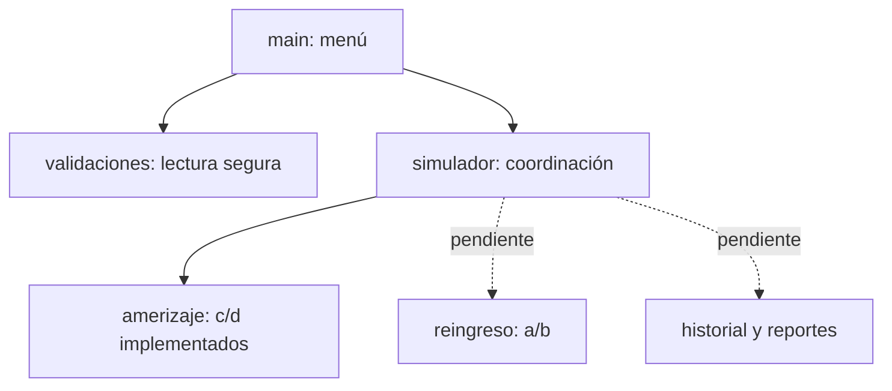

# Simulador Artemis — Escenario 4

Trabajo Final Integrador de **Algoritmos y Estructuras de Datos**, Ingeniería en Sistemas de Información, UTN Facultad Regional Resistencia. Programa en C, nativo por consola.

> **Base de desarrollo compartida, no entrega final.** Funcionan el menú inicial y los incisos c/d de Alexis. Los incisos a/b, los datos personalizados, el ciclo por eventos y el historial/reporte completo están pendientes. La demo no representa una misión completa.

## Equipo y comisión

Comisión: **pendiente de completar**.

| Integrante | Legajo | Responsabilidad confirmada |
| --- | --- | --- |
| Quatrin Oliver Alexis Javier | 27880 | Amerizaje y ángulo: incisos c/d |
| Navarro Ezequiel Leandro | 31372 | Pendiente de asignar |
| Julian Nicolas Alvarez Carruega | 29342 | Pendiente de asignar |
| Juan Ignacio Pabon | 28583 | Pendiente de asignar |
| Nombre pendiente | Pendiente | Pendiente de asignar |

El integrante restante completará sus datos. Las cuatro tareas distintas de c/d todavía no tienen responsable confirmado; los números siguientes identifican partes del trabajo, no personas asignadas.

| Responsable | Parte | Archivo principal / entrega |
| --- | --- | --- |
| Integrante 1 — nombre pendiente | Reingreso y frenado: incisos a/b | `reingreso.c` (por crear), pruebas y explicación física |
| **Quatrin Oliver Alexis Javier (Alexis)** | Amerizaje y ángulo: incisos c/d | `amerizaje.c`, pruebas y explicación física |
| Integrante 3 — nombre pendiente | Flujo, estados y eventos | `simulador.c`, contratos en `simulador.h` |
| Ignacio Pabon | Entradas, validaciones y menú | `validaciones.c/.h` y `main.c` |
| Integrante 5 — nombre pendiente | Arreglo de historial, reportes y compilación | `reportes.c/.h` (por crear), Makefile |

Cada integrante programa, prueba y documenta su aporte. README, revisión, Git, video y preparación del coloquio son responsabilidades compartidas.

## Escenario y modelo propuesto

Orion regresa a la Tierra y debe disipar energía antes de amerizar. Valores de referencia de la consigna:

| Dato | Valor |
| --- | --- |
| Masa de la cápsula | 10.400 kg |
| Rapidez inicial / altitud de entrada | 11.000 m/s / 120.000 m |
| Rapidez / altitud al abrir paracaídas | 25 m/s / 2.500 m |
| Duración indicada para la mayor desaceleración | 400 s |
| Rapidez de impacto / hundimiento | 8 m/s / 1,50 m |
| Ventana segura del ángulo de entrada | 5,5° a 7,0°, inclusive |

Se propone un simulador por eventos: configurar datos, evaluar reingreso, avanzar a paracaídas, evaluar amerizaje y emitir/guardar el reporte. El usuario podrá repetir simulaciones y compararlas. **Este flujo está por implementar**; los modelos y reglas definitivos deben acordarse en equipo. No agregar vidas, puntajes o límites estructurales como si fueran requisitos de la cátedra.

Modelo actual c/d: movimiento vertical de detención, masa y gravedad constantes, fuerza del agua promediada respecto del desplazamiento. Incluye el trabajo del peso: `Fagua = m*g + m*v²/(2*d)`. Con los datos de referencia: **323.786,67 N**, **3,1769 veces el peso**. El ángulo se clasifica cualitativamente; no se calcula trayectoria ni temperatura y la ventana no garantiza toda la misión. [Fórmulas y límites](docs/parte-alexis.md).

## Compilación y ejecución

Requisitos: GCC compatible con C17 y GNU Make; biblioteca matemática estándar. Python 3 solo es necesario para las pruebas automáticas del menú, no para compilar o usar el simulador. Sin servicios externos, claves ni paquetes adicionales de C.

Desde la raíz del repositorio, en Linux o una terminal MSYS2 UCRT64 en Windows:

```sh
make          # Compila build/artemis (artemis.exe en Windows)
make run      # Ejecuta el menú actual
make demo     # Ejecuta directamente la demostración c/d
make test     # Ejecuta las 55 comprobaciones C de Alexis
make check    # Ejecuta las pruebas C y las 7 pruebas de menú con Python
make clean    # Elimina los ejecutables generados
```

Si Python se invoca como `python` en tu equipo: `make check PYTHON=python`.

### Windows sin VS Code

Instalar [MSYS2](https://www.msys2.org/) en la ubicación habitual. Abrir **MSYS2 UCRT64**, actualizar siguiendo sus indicaciones y ejecutar:

```sh
pacman -Syu
# Si solicita cerrar la terminal, reabrir UCRT64 y repetir la actualización.
pacman -S mingw-w64-ucrt-x86_64-gcc make git
cd "/c/Users/TU_USUARIO/Downloads/Trabajo-Integrador-C"
make run
```

Ajustar la ruta a la carpeta real. La terminal UCRT64 evita depender de una configuración previa de PowerShell o VS Code. Las instrucciones Windows están documentadas; la validación ejecutada en este entorno fue en Linux. Para `make check`, instalar además Python 3 o usar un Python ya disponible.

### Funcionamiento actual

1. Elegir `1` para ejecutar los datos fijos de la consigna y ver cinco clasificaciones de ángulo.
2. Elegir `2` para consultar qué está implementado y qué falta.
3. Elegir `0` para salir. El fin de entrada también termina sin bucles infinitos.

El menú rechaza letras, líneas vacías, números fuera de rango, sufijos y líneas demasiado largas. Aún falta leer y validar las magnitudes físicas ingresadas por el usuario.

## Arquitectura

```text
main.c                 menú e inicialización; una sola función main
validaciones.c/.h      lectura segura de la opción del menú; ampliar para datos
simulador.h            constantes, structs, enum y contratos compartidos
simulador.c            coordinación; actualmente demostración parcial
amerizaje.c            cálculos y clasificación de Alexis (c/d)
reingreso.c            PENDIENTE: cálculos a/b
reportes.c/.h          PENDIENTE: historial y reportes finales
```



Las demos y pruebas tienen sus propios `main` en ejecutables separados. No compilar todos los `.c` con un comodín: eso enlazaría varios `main`. El Makefile enumera las fuentes explícitamente. Los binarios de `build/` no se versionan.

## Trabajo colaborativo y requisitos de entrega

- [Cómo trabajar con ramas y Pull Requests](CONTRIBUTING.md).
- [Tareas concretas de los cinco integrantes](docs/tareas-equipo.md).
- [Lista de requisitos y evidencias](docs/requisitos.md).
- [Explicación de la parte de Alexis](docs/parte-alexis.md).

El repositorio de entrega debe ser **público** y mostrar commits progresivos reales de todos. Ramas y PR son recomendados por la consigna. La protección de `main` y el acceso de colaboradores se configuran en GitHub: los archivos de este proyecto no los activan.

La entrega final requiere código `.c/.h`, Makefile o script, README completo y video de hasta 5 minutos con aparición y voz real de todos, arquitectura, caso exitoso y entradas erróneas. No se permiten voces o participantes sustituidos por IA. Todos deben comprender el sistema para una posible defensa individual. La fecha de entrega no está especificada en el PDF; verificar el aula virtual.

## Registro de uso de IA

Herramienta: ChatGPT/Codex. Registro del 3 de noviembre de 2026.

| Consulta del usuario | Uso de la herramienta |
| --- | --- |
| «Somos un grupo de 5 personas [...] decime como podemos dividirnos el trabajo [...] Nos toco el escenario 4» | Lectura de la consigna y propuesta de distribución de responsabilidades. |
| «armame un doc para pasar al grupo de whatsapp, con la division de partes» | Generación de un documento de organización. |
| «arranquemos con mi parte, teniendo en cuenta todos los requerimientos del trabajo integrador» | Generación del módulo C de amerizaje y ángulo, demostración, pruebas y documentación. |

Validación realizada por la herramienta: compilación C17 con advertencias tratadas como errores, ejecución de la demo y 55 comprobaciones automáticas aprobadas. Se incluyó el trabajo del peso para distinguir fuerza del agua de fuerza neta; se documentaron los supuestos físicos y los límites del modelo. Se separaron las funciones de cálculo de la entrada/salida para integrarlas con el resto del equipo.

Revisión y adaptación por los estudiantes: **pendiente**. Cada integrante debe registrar aquí qué verificó, modificó o descartó. La validación automatizada no acredita que el equipo comprenda o haya revisado personalmente el código.


### Preparación de la base compartida

Consulta: «armemos el repo que vamos a usar con el grupo para el trabajo integrador, leete de vuelta el pdf del trabajo que te habia mandado».

ChatGPT/Codex releyó la consigna completa, separó c/d en `amerizaje.c`, agregó un menú base, lectura segura de enteros, pruebas del ejecutable, documentación de requisitos/tareas, guía de contribución y configuración de CI. Se mantuvo pendiente la implementación de las partes de los compañeros. Se ejecutaron en Linux la compilación estricta, la demo, 55 comprobaciones C y 7 pruebas del menú; todas pasaron. La configuración de CI se ejecutará en GitHub cuando se publique y no equivale a una ejecución ya observada allí. Windows no fue probado en este entorno.
